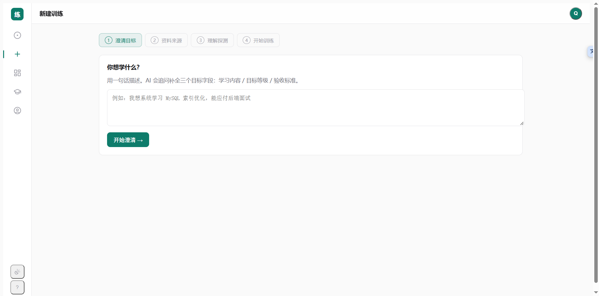
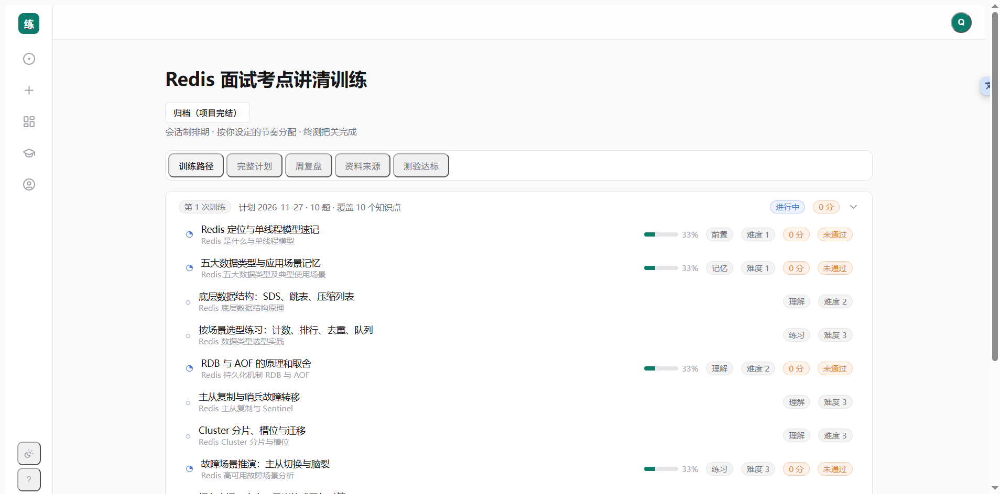
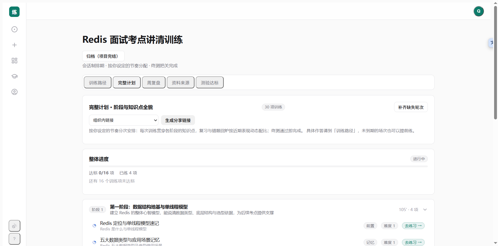
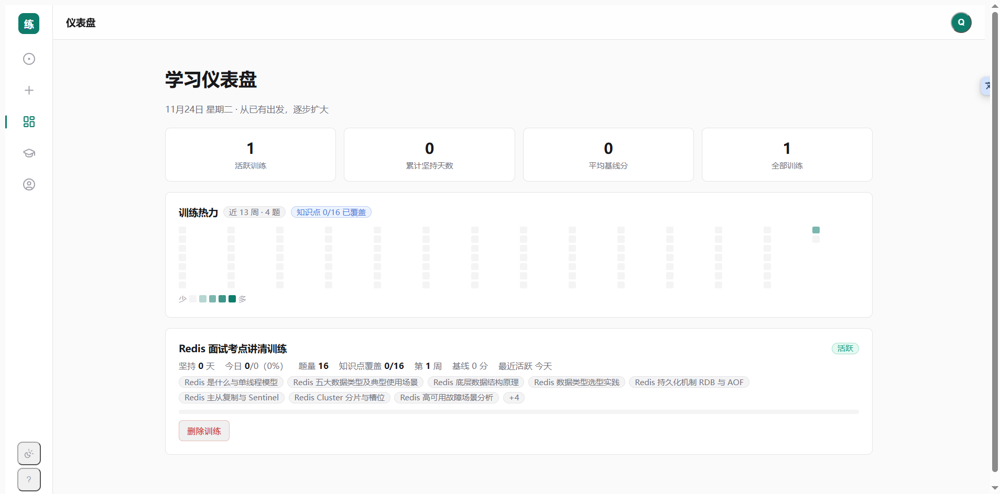

<div align="center">

# Trainer

**Bring your own material. AI writes questions from it, grades point by point, and remembers where you went wrong.**

A personal training coach · Python (FastAPI) + Vue 3 + SQLite

[简体中文](README.md) · English

[Quick start](#quick-start) · [What it is](#what-it-is) · [Architecture](#architecture) · [Contributing](#contributing)

</div>

## Screenshots

The interface is currently Chinese-only.

| | |
| --- | --- |
| **New training**: one sentence for your goal, AI fills in the rest | **Training path**: what to practice in each session |
|  |  |
| **Full plan**: every knowledge point, by stage | **Dashboard**: progress and training heatmap |
|  |  |

> The repository name says “agent”, but **it is not an agent yet**: there is no autonomous planning and no tool calling.
> It is a fixed workflow orchestrated by rules, with a handful of model calls embedded in it. For why it is designed
> this way and where it is heading, see [What it is](#what-it-is) and [Roadmap](#roadmap).

## What it is

Three things tend to break when you learn something on your own: the material gets saved and never read; you read it
but do not know whether you can actually do it; and review happens by feel. Trainer connects them into one loop:

1. **State the goal.** Describe what you want to learn in one sentence. AI drafts a target level and acceptance
   criteria, and you edit them until you are happy. Values you set explicitly are never overwritten by AI.
2. **Import material.** Upload PDF / Word / Excel / Markdown / TXT, paste text directly, or give a URL.
3. **Probe your edge.** One question per knowledge point locates you as “mastered / on the edge / not yet”.
4. **Generate the training path.** Mastered points are skipped, points on the edge become the focus, and unreached
   points get prerequisites first.
5. **Daily practice.** Every day the system writes questions from your material, you answer, and it grades. When you
   miss, you get an explanation that cites the material and compares your earlier attempts.
6. **Tests and review.** After a cooldown, variant questions check whether it stuck; a weekly review suggests how to
   recalibrate.

### Three design decisions

| Decision | How | Why |
| --- | --- | --- |
| The model testifies; the rules judge | The model only labels each rubric point “hit / partial / wrong / missing”, and must quote your own words as evidence. The score and the pass/fail call are computed by the rule layer | Verdicts are auditable and reproducible, and swapping the model does not quietly move the bar |
| Memory is structured state | No chat transcripts are kept. Every attempt is stored as a fact; mastery and the list of active misconceptions are derived by replaying those attempts | Memory can be queried and rebuilt, and does not depend on the context window |
| Every model call is audited | All calls go through a single client, and each one (success, fallback, or failure) logs the prompt version, latency, and tokens | Every result traces back to “which prompt version, which model, at what cost” |

### Also included

- Multiple-choice and fill-in-the-blank questions are graded deterministically, with no model call
- Learner model: per-knowledge-point mastery that decays over time, plus active misconceptions
- Dashboard, training heatmap, knowledge-point coverage, session summaries, repeated-miss reminders
- Three visibility levels for trainings and materials, share links that import a copy, organizations and member roles
- Dark / light / follow-system themes

### What it is not

- **Not an agent.** See the note at the top.
- **Not a RAG chatbot.** There is no vector search. The material is there to keep questions and explanations grounded,
  not to answer free-form questions.
- **Not a replacement for flashcard apps.** Review intervals are fixed rule-of-thumb constants for now; see
  [Evidence boundaries](#evidence-boundaries).

## Quick start

You need Python 3.12, Node.js 20 or later, and a model service compatible with the OpenAI `/chat/completions` API
(DeepSeek by default; it also starts without a key, see [FAQ](#faq)).

```bash
git clone https://github.com/q1ngn1ng-web/trainer.git
cd trainer

# 1) Backend dependencies (needs uv: https://docs.astral.sh/uv/ ; `pip install uv` works too)
uv venv && source .venv/bin/activate
uv pip install -r requirements.txt

# 2) Configure the model
cp .env.example .env      # edit .env and fill in DEEPSEEK_API_KEY

# 3) Initialize the database
python -m src.cli init-db

# 4) Frontend
cd web && npm install && npm run build && cd ..

# 5) Start
uvicorn src.api.app:app --port 8501
```

Open <http://127.0.0.1:8501> and register an account to get started. Accounts and data live only in your local SQLite file.
Run the start command from the project root, otherwise `.env` is not read.

**On networks in mainland China**, direct access to PyPI and the npm registry can be extremely slow or time out, and
cloning can be slow too. If cloning stalls, use the SSH address `git@github.com:q1ngn1ng-web/trainer.git`; add mirrors to
the two install commands:

```bash
uv pip install -r requirements.txt -i https://pypi.tuna.tsinghua.edu.cn/simple
cd web && npm install --registry=https://registry.npmmirror.com && npm run build && cd ..
```

<details>
<summary>Prefer not to install uv? Use the venv that ships with Python</summary>

Replace step 1 with:

```bash
python -m venv .venv && source .venv/bin/activate
pip install -r requirements.txt
```

On Ubuntu, if you see `ensurepip is not available`, run `sudo apt install python3-venv` first.

</details>

### Environment variables

| Variable | Default | Description |
| --- | --- | --- |
| `DEEPSEEK_API_KEY` | none | API key for the model service. **Required** |
| `DEEPSEEK_BASE_URL` | `https://api.deepseek.com` | Model service base URL. By the API contract it can be swapped for any `/chat/completions`-compatible service; not verified one by one |
| `DEEPSEEK_MODEL` | `deepseek-v4-flash` | Model name |
| `TRAINER_AUTH` | `1` | `1` requires login. `0` is a legacy no-login mode in which creating a training currently fails; not recommended |
| `TRAINER_COOKIE_SECURE` | `0` | Set to `1` when serving over HTTPS |
| `TRAINER_TZ` | `Asia/Shanghai` | Time zone used to decide “today”. Must be set as a real environment variable; putting it in `.env` currently has no effect |
| `DB_PATH` | `./data/trainer.db` | SQLite file location |

### FAQ

- **The home page returns 404.** The frontend has not been built. The backend serves pages only when `web/dist` exists;
  finish step 4 first.
- **The API returns `no such table`.** You have not run `python -m src.cli init-db`.
- **No API key.** The server starts and the wizard can be completed, but everything that depends on the model takes a
  fallback path: goal clarification becomes a form you fill in yourself, probing and question generation fall back to
  generic prompts, and free-text answers are not graded.
- **Changing the port.** Pass a different `--port`. Pages and API come from the same process; nothing else to configure.

## Architecture

What one daily answer goes through:

```
Today's tasks ──► Question written from your material ──► You answer
                                                               │
Rules compute the score ──► Attempt record (source of truth) ◄─┘ Model labels each rubric point
           │                                 │
   Pass/fail, mastery        Learner model (rebuildable from attempts)
```

```
src/
├── api/app.py      All HTTP endpoints and the login middleware
├── core/           Pure domain logic: scheduling, mastery, session composition, permission checks (no database, no model)
├── services/       Orchestration: questions, grading, explanations, plans, memory, sharing…
├── llm/            Single model client, prompt and JSON Schema registries, retry and fallback
├── db/             SQLite: schema, idempotent migrations, queries
└── main.py, ui/    First-generation UI (Streamlit), retired and being removed — do not build on it
web/                Vue 3 + TypeScript + Tailwind CSS frontend
tests/              Backend tests
scripts/            Evaluation and smoke scripts
workspace/
├── store/openspec/ Specs and change proposals
└── decisions/      Architecture decision records
docs/               Architecture notes, training theory, and screenshots (images/)
```

## Tests

```bash
pytest tests/ -q          # a full run takes about 6 minutes
cd web && npm run build   # the frontend has no automated tests yet; a passing build is the gate
```

## Evidence boundaries

Before you use it to convince yourself (or anyone else), know where it stops:

- **Grading consistency has only been measured on a tiny sample.** Six rubric-point verdicts were blind-labeled by a
  human: under the strict four-state scheme, 0 matched the model exactly; relaxed to a binary “answered / not answered”,
  4 matched. The disagreement concentrates on where “answered” ends. The grading rubric is still being calibrated, and
  help with labeling is welcome.
- **Review intervals are rule-of-thumb constants.** A fixed five rounds (day 1 / 3 / 7 / 15 / 30), a 14-day cooldown,
  and a 30-day mastery half-life, identical for everyone. Scheduling from a forgetting curve is planned.
- **There is no controlled evidence of learning outcomes.** Nothing yet shows that “using it helps you learn better”.

## Roadmap

Plans, not promises; each item has a proposal under `workspace/store/openspec/changes/`.

- **Near term**: open-source release gate (dependencies, docs, guardrails for public deployments); removal of the
  first-generation code
- **Mid term**: coach dialogue (exposing the existing services as tools the model can call); forgetting-curve scheduling
  to replace the fixed intervals; retrieval over the material before question generation

## Contributing

This is a personal project built while using it, and you are welcome to start anywhere.

- **Starter tasks**: issues labeled `good first issue` will appear over time, each with acceptance criteria.
- **Spec first, then code**: new features start as a proposal under `workspace/store/openspec/changes/`, then get
  implemented, then archived. The workflow conventions for AI collaborators are in `AGENTS.md` at the repository root.
- **Tests**: for changes touching visibility, permissions, or filtering, please include cases that go through the HTTP
  endpoints, plus cross-user isolation cases. This project has been bitten repeatedly by “the function was right, the
  wiring was broken, the tests were green”.
- **Commit messages**: `type(scope): summary`, with type taken from feat / fix / docs / refactor / chore.

## License

[MIT](LICENSE)
